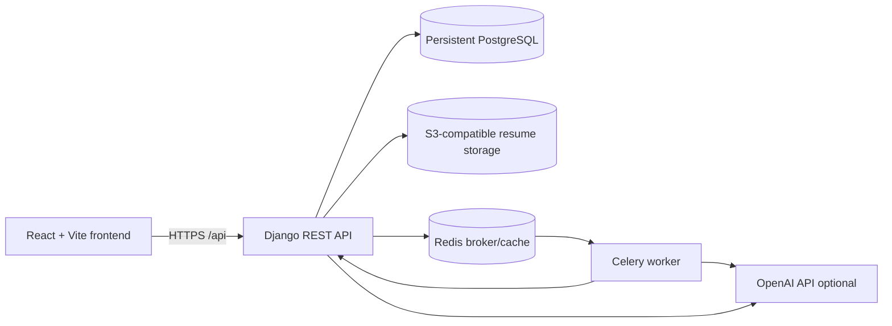

# Architecture

The local default remains SQLite, filesystem uploads, and synchronous fallback mode.
Production uses PostgreSQL, S3-compatible object storage, Redis, and a separate
Celery worker. Resume parsing, job scans, matching, application generation, and
assistant work can be submitted through the task API and polled by task ID.
